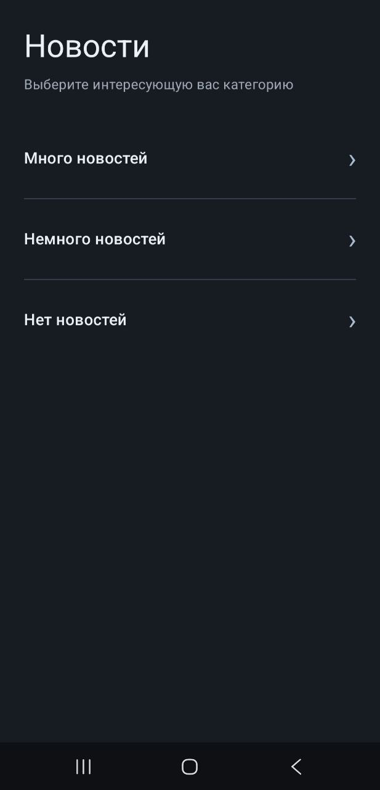
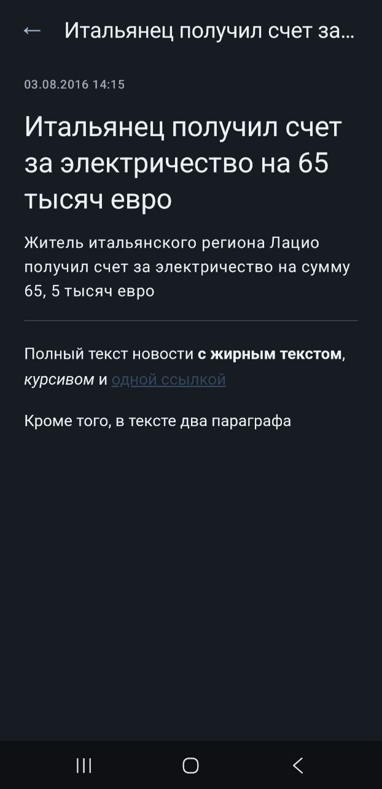

# Новости

Android-приложение для просмотра новостей по категориям и чтения полных публикаций.


## Скриншоты приложения

### Категории


### Список новостей


### Подробная информация о новости


## Функциональность

- Просмотр списка категорий.
- Просмотр новостей выбранной категории.
- Постраничная загрузка новостей (по 10 элементов).
- Просмотр подробной информации о новости.
- Отображение полного текста новости в формате HTML.
- Локальное сохранение загруженных данных.
- Использование сохранённых данных при отсутствии подключения к интернету.
- Обработка ошибок загрузки и возможность повторного запроса.

## Используемые технологии

- Kotlin
- Jetpack Compose
- Material 3
- MVVM
- Kotlin Coroutines
- StateFlow
- Retrofit
- Gson
- Room
- Navigation Compose
- WebView
- JUnit
- MockK

## Структура проекта

```text
com.example.newsapp
├── core
│   └── preferences
├── data
│   ├── remote
│   │   └── dto
│   ├── local
│   │   ├── entity
│   │   ├── dao
│   │   └── database
│   ├── mapper
│   └── repository
├── domain
│   ├── model
│   ├── repository
│   └── usecase
├── presentation
│   ├── navigation
│   ├── categories
│   ├── news
│   ├── details
│   ├── common
│   └── theme
├── di
└── MainActivity.kt
```

## API

Для получения данных используются следующие запросы:

| Метод | Endpoint | Назначение |
|---|---|---|
| GET | `/v1/news/categories` | Получение категорий |
| GET | `/v1/news/categories/{id}/news?page={page}` | Получение списка новостей |
| GET | `/v1/news/details?id={id}` | Получение подробной информации о новости |

Успешный ответ API определяется значением `code = 0`.

## Запуск проекта

1. Клонировать репозиторий:

```bash
git clone https://github.com/Jeywoods/NewsApp.git
```

2. Открыть проект в Android Studio.
3. Дождаться завершения синхронизации Gradle.
4. Запустить приложение на эмуляторе или подключённом Android-устройстве.

## Запуск тестов

Для запуска модульных тестов:

```bash
./gradlew testDebugUnitTest
```

Для запуска UI-тестов на подключённом устройстве или эмуляторе:

```bash
./gradlew connectedDebugAndroidTest
```

## Тестирование

В проекте реализованы:

**Модульные тесты:**
- Мапперы DTO и локальных моделей.
- Обработка ответов API.
- Репозиторий.
- Use Cases.
- ViewModels.

**UI-тесты:**
- CategoriesScreen.
- NewsScreen.
- NewsDetailsScreen.

Всего на текущий момент успешно пройдены 82 теста: 58 модульных и 24 UI-теста.
